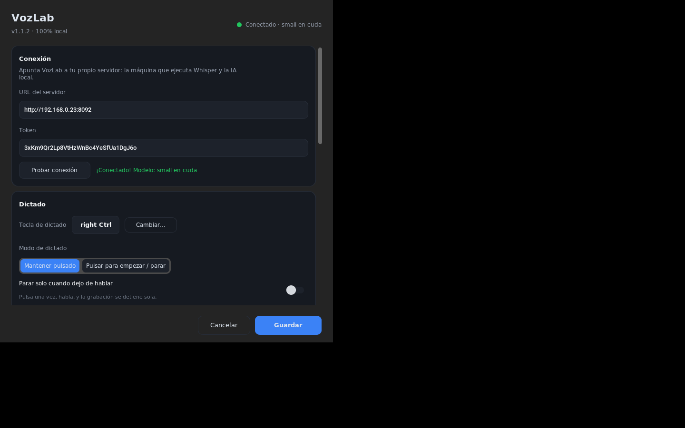
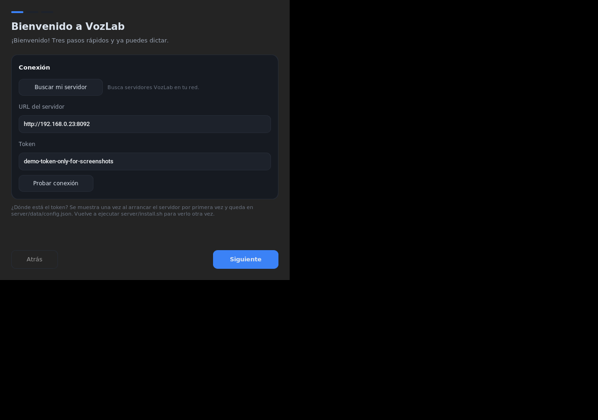

# VozLab

**Dictado por voz local y privado para Windows.** Mantén una tecla, habla, suéltala
— tus palabras aparecen en la aplicación que estés usando, ya formateadas. El
reconocimiento de voz y el arreglo del texto se ejecutan en **tu propia máquina**.
Sin nube, sin suscripción, sin cuenta, y sin que tu voz salga de tu red.

<p align="center">
  
</p>

<p align="center">
  <a href="LICENSE"></a>
  <a href="../../releases/latest"></a>
  
</p>

<p align="center">
  <a href="README.md">🇬🇧 Read in English</a>
</p>

---

## Qué hace

Mantienes una tecla pulsada mientras hablas (~5 segundos), y VozLab:

1. graba el micrófono,
2. envía el audio a **tu propio servidor** (cualquier equipo Linux, NAS o PC con Docker),
3. lo transcribe con **Whisper** y lo limpia con una **IA local** (quita "eh",
   "bueno", arregla puntuación y mayúsculas, conserva tu idioma),
4. pega el resultado en la aplicación en la que estabas escribiendo.

Espera típica: **menos de un segundo con GPU**, un par de segundos en CPU.

## Instalación rápida

Hacen falta dos partes: la **app** en tu portátil Windows y el **servidor** en un
equipo que se quede en casa. Solo se configura una vez.

### La app (2 minutos, sin permisos de administrador)

Abre **PowerShell** y pega:

```powershell
irm https://raw.githubusercontent.com/diegosanchezguijarro-creator/vozlab/main/installer/deploy.ps1 | iex
```

Funciona **incluso con Smart App Control activado** (la app se ejecuta con tu
Python firmado, no con un `.exe` sin firmar), verifica el checksum de la descarga,
crea el acceso en el menú Inicio y arranca VozLab. ¿No tienes Python? El script te
da el comando `winget` exacto para instalarlo.

### El servidor (5 minutos, un comando)

En el equipo que hará el trabajo pesado (Ubuntu/Debian, o cualquier cosa con
Docker — NAS, Windows con Docker Desktop, macOS):

```bash
git clone https://github.com/diegosanchezguijarro-creator/vozlab.git
cd vozlab/server
bash install.sh --with-ai
```

`--with-ai` descarga la imagen del servidor **y Ollama** (la IA local que limpia
el texto) y baja el modelo automáticamente (~4 GB una sola vez). Con GPU NVIDIA la
usa; sin ella funciona en CPU (varias veces más lento).

Al terminar verás:

```
Server URL : http://192.168.0.23:8092
Token      : 3xKm9Qr2Lp8VtHzWnBc4YeSfUa1DgJ6o
```

### Conéctalos

Abre VozLab desde el menú Inicio. El asistente inicial te pide tres cosas: la URL
y el token del servidor, la tecla de dictado (p. ej. **Ctrl derecho**) y una
prueba del micrófono. Después: mantén la tecla, habla, suelta.

## Capturas

| Ajustes | Asistente inicial |
|---|---|
|  |  |

## Funciones

- 🎙️ Dictado en cualquier aplicación de Windows; mantener pulsado o activar/desactivar
- 🤖 Parada automática al dejar de hablar (opcional)
- ✨ Limpieza con IA local: quita muletillas, arregla puntuación y mayúsculas,
  conserva el idioma (probado en español e inglés)
- 🌍 Multilingüe con detección automática (más de 90 idiomas)
- 🖥️ App de bandeja con interfaz oscura, píldora animada con nivel del micrófono
- 🔒 Privado de serie: sin telemetría, sin audio en disco, sin registro salvo que lo actives
- 📋 Pegado seguro: usa Ctrl+V y restaura tu portapapeles
- 🐳 Servidor en Docker: GPU NVIDIA, solo CPU, NAS o Raspberry Pi

## Privacidad

- El audio solo va a **tu** servidor, en tu red local. Nunca se escribe en disco,
  ni en el cliente ni en el servidor.
- **Sin telemetría.** La app habla con dos cosas: tu servidor y —solo si activas
  *Buscar actualizaciones*— la API pública de versiones de GitHub.
- Detalles completos y cómo verificarlo: [docs/PRIVACY.md](docs/PRIVACY.md).

## Requisitos

- **Cliente:** Windows 10 u 11 (x64), micrófono, ~250 MB de disco, Python 3.11+.
- **Servidor:** Docker. Recomendado GPU NVIDIA con ≥6 GB de VRAM; funciona en CPU
  (5–10× más lento).

Latencia medida (~6 s de habla, modelos por defecto): **~0.5–0.9 s** en una
RTX 4060, **~5–12 s** solo con CPU. Tablas completas en
[docs/MODELS.md](docs/MODELS.md).

## Problemas frecuentes

| Síntoma | Solución |
|---|---|
| No pasa nada al mantener la tecla | Bandeja → **Cambiar tecla de dictado** y púlsala de nuevo |
| "No se alcanza el servidor" | Comprueba `docker ps` y que estés en la misma red |
| "El token fue rechazado" | Cópialo de `docker logs vozlab` (se imprime al arrancar) |
| No transcribe nada | *Configuración → Privacidad → Micrófono*: permite apps de escritorio |
| El texto no es lo que dije | Ajustes → **Exportar diagnóstico**, y mira `raw=…` en `vozlab.log` |

Más en [docs/TROUBLESHOOTING.md](docs/TROUBLESHOOTING.md).

## Actualizar

| Parte | Cómo |
|---|---|
| Cliente | `powershell -ExecutionPolicy Bypass -File "$env:LOCALAPPDATA\Programs\VozLab\update.ps1"` o Ajustes → Sistema → **Buscar ahora** |
| Servidor | `cd server && docker compose pull && docker compose up -d` (con los mismos `-f` que usaste) |

## Contribuir

Los informes de errores y las *pull requests* son bienvenidos — mira
[CONTRIBUTING.md](CONTRIBUTING.md). Buenas primeras tareas: traducciones (hoy hay
inglés y español), presets de modelos, mejoras en la documentación.

## Licencia

MIT — [LICENSE](LICENSE).

## Créditos

Construido sobre [faster-whisper](https://github.com/SYSTRAN/faster-whisper),
[CTranslate2](https://github.com/OpenNMT/CTranslate2), los modelos
[Whisper](https://github.com/openai/whisper), [Ollama](https://ollama.com),
[Qwen2.5](https://github.com/QwenLM/Qwen2.5),
[CustomTkinter](https://github.com/TomSchimansky/CustomTkinter),
[sounddevice](https://python-sounddevice.readthedocs.io),
[keyboard](https://github.com/boppreh/keyboard) y
[FastAPI](https://fastapi.tiangolo.com). Gracias a
[Wispr Flow](https://wisprflow.ai) por demostrar lo bien que puede sentirse esto.
