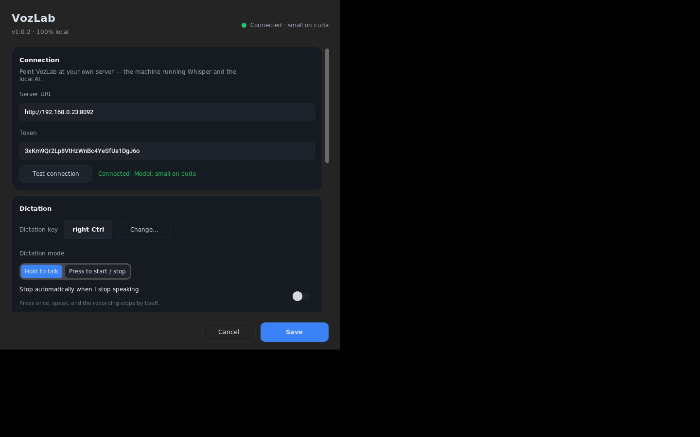

# VozLab

**Local, private voice dictation — talk to your own computer, in any app.**

Hold a key, speak, release: your words appear where your cursor is. Speech
recognition and text cleanup run on **your own hardware** (a machine with a GPU,
a NAS, or any Linux box on your network). No cloud, no subscription, no audio
leaving your LAN.

<p align="center">
  
  <br>
  <em>Hold your key and speak — the pill shows a live mic level.</em>
</p>

<table>
<tr>
<td width="50%"></td>
<td width="50%"></td>
</tr>
<tr>
<td align="center"><em>Everything in one window</em></td>
<td align="center"><em>Three-step first-run setup</em></td>
</tr>
</table>

<p align="center">
  
  
</p>

```
                 your laptop (Windows)                  your server (any machine on your LAN)
   ┌───────────────────────────────────────┐   ┌────────────────────────────────────────────┐
   │  VozLab app                           │   │  VozLab server (Docker)                    │
   │                                       │   │                                            │
   │  hold right Ctrl ──► record mic       │   │  Whisper (speech → text, GPU or CPU)       │
   │        │                              │   │            │                               │
   │        └── POST /transcribe ──────────┼──►│            ▼                               │
   │                                       │   │  LLM cleanup (punctuation, filler words)   │
   │  paste into the focused app ◄─────────┼───┤  returns formatted text                    │
   └───────────────────────────────────────┘   └────────────────────────────────────────────┘
```

## Features

- **Push-to-talk or toggle** dictation into any Windows app
- **Beautiful, dark, native-feeling UI** (CustomTkinter): tray icon, animated
  status pill with a live microphone level, setup wizard, grouped settings
- **Automatic text cleanup** — removes "um/uh", fixes punctuation and capitalization, keeps your language
- **Multilingual** — auto-detects your language; Spanish and 90+ others
- **Auto-stop** mode: press once, speak, and it stops when you stop talking
- **Clipboard-safe**: your clipboard is restored right after pasting
- **100% local** — nothing is uploaded anywhere

## Quick start

### 1. Server (5 minutes)

On a machine with Docker (NVIDIA GPU recommended; CPU works too):

```bash
git clone https://github.com/<your-user>/vozlab.git
cd vozlab/server
bash install.sh
```

The installer prints the URL and **token** to use in the app. Full details:
[docs/SERVER.md](docs/SERVER.md).

### 2. Windows app (2 minutes)

Download `VozLab-Setup-x.y.z.exe` from
[Releases](../../releases), run it (per-user install, no admin needed), and
follow the wizard:

1. Paste the server URL + token → *Test connection*
2. Press the key you want to use for dictation
3. Test your microphone → done

Then hold your key, speak, release. Details:
[docs/CLIENT.md](docs/CLIENT.md).

> **First run:** Windows SmartScreen may warn about an unknown publisher
> (the app is not code-signed). Click *More info* → *Run anyway*.

## Requirements

| | Minimum | Recommended |
|---|---|---|
| Server OS | Any Linux with Docker | Ubuntu 22.04+ / 24.04 |
| Server GPU | CPU only (works, ~5-10× slower) | NVIDIA with ≥6 GB VRAM |
| Server RAM | 4 GB | 8 GB+ |
| Client | Windows 10/11 x64 | Windows 11 |

## Privacy

- Audio is sent only to the server you configure (your own machine), over your LAN.
- The server keeps no recordings, no history, no database — audio is processed in
  memory and discarded.
- The cleanup LLM (via [Ollama](https://ollama.com)) also runs locally.
- The Windows app makes exactly two kinds of request: `/health` (startup check)
  and `/transcribe` (your recording). You can verify this in `client/vozlab/api.py`.

## How it works

1. The app records 16 kHz mono audio while your hotkey is held.
2. `POST /transcribe` sends WAV bytes with your token.
3. The server runs **faster-whisper** (CTranslate2) on GPU when available,
   with Silero VAD to trim silence.
4. The transcript is passed to a local LLM (default `llama3.1:8b` via Ollama)
   with a "dictation formatter" prompt: filler words out, punctuation and
   capitalization fixed, original language preserved, nothing added.
5. The client pastes the result into the focused window (`Ctrl+V`, clipboard
   restored afterwards).

Typical latency on an RTX 4060: **0.7–2 s** for a sentence, including cleanup.

## Repository layout

```
server/     Docker-based transcription + cleanup service (FastAPI)
client/     Windows tray app (CustomTkinter UI; built to .exe with PyInstaller)
installer/  Inno Setup script producing VozLab-Setup-x.y.z.exe
docs/       Setup, build and troubleshooting guides (+ UI screenshots)
.github/    CI (tests on Linux+Windows) and release pipeline
```

## Configuration

Server settings: `server/data/config.json` (whisper model, language, cleanup
model/prompt, port). Client settings: tray icon → **Settings** — or
`%APPDATA%\VozLab\config.json`.

See [docs/SERVER.md](docs/SERVER.md) and [docs/CLIENT.md](docs/CLIENT.md).

## Development

```bash
# server
cd server && docker compose up -d --build

# client (any OS, for development)
cd client
pip install -r requirements.txt -r requirements-dev.txt
python -m pytest tests -q
python run_vozlab.py
```

Build the Windows installer: [docs/BUILD.md](docs/BUILD.md).
Something not working? [docs/TROUBLESHOOTING.md](docs/TROUBLESHOOTING.md).

## License

MIT — see [LICENSE](LICENSE).
