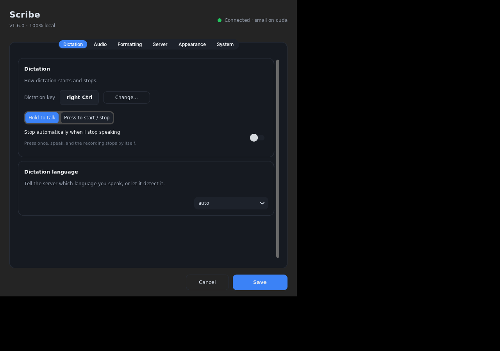
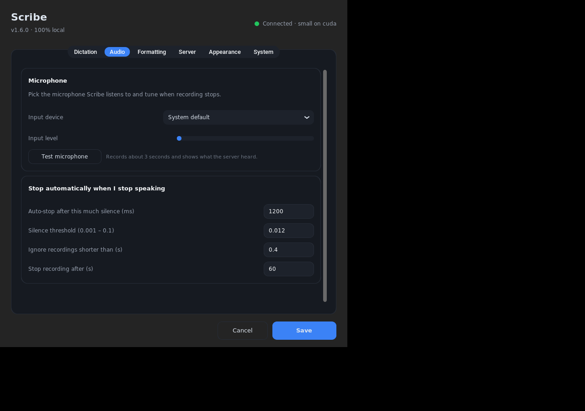
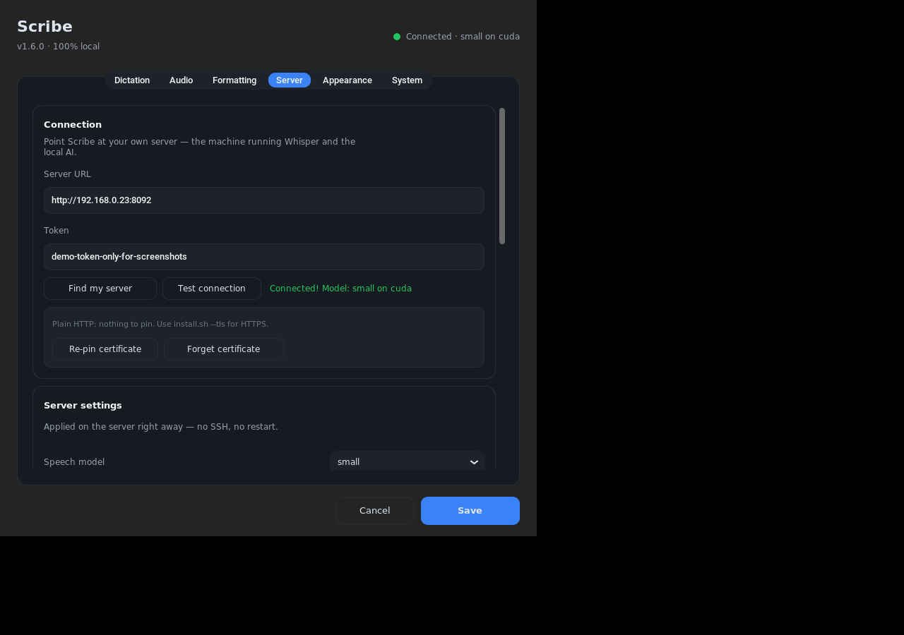
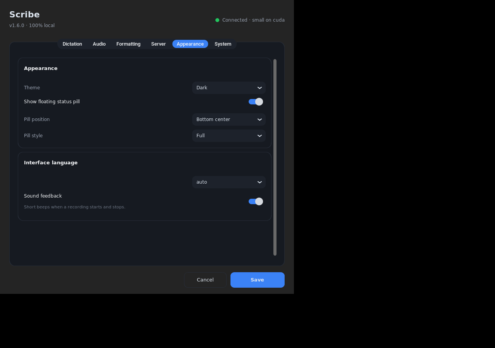
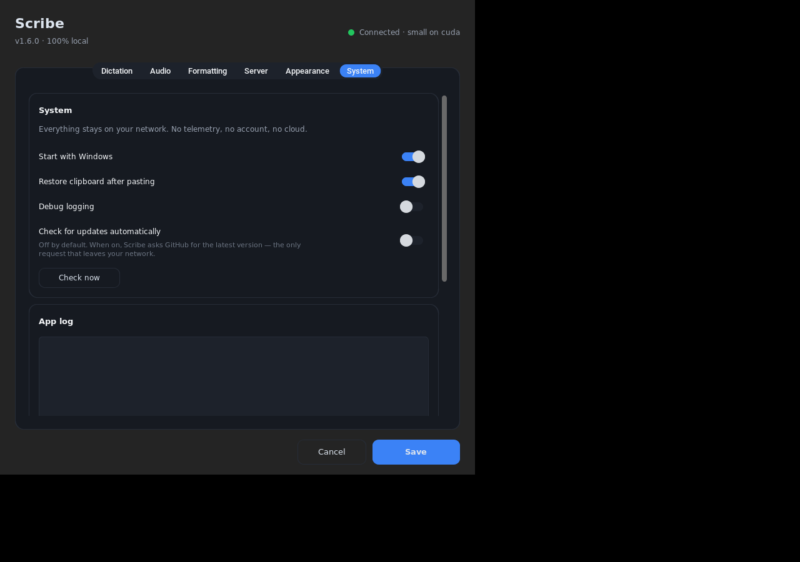
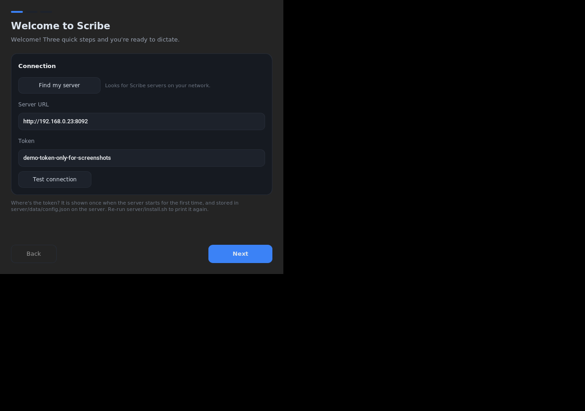
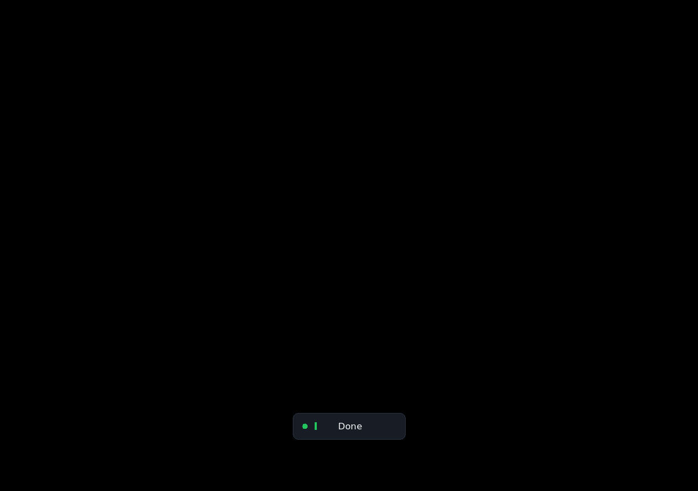

# Scribe

**Local, private voice dictation for Windows.** Hold a key, speak, release — your
words appear in whatever app you're using, formatted. Speech recognition and text
cleanup run on **your own machine**. No cloud, no subscription, no account, and no
audio leaving your network.

<p align="center">
  
</p>

<p align="center">
  <a href="LICENSE"></a>
  <a href="../../releases/latest"></a>
  <a href="../../actions/workflows/ci.yml"></a>
  
  
  
</p>

<p align="center">
  <a href="README.es.md">🇪🇸 Leer en español</a>
</p>

---

## What it does

You keep a key held while you talk (~5 seconds of speech), Scribe:

1. records the microphone,
2. sends the audio to **your own server** (any Linux box, NAS or PC with Docker),
3. transcribes it with **Whisper** and cleans it up with a **local LLM**
   ("um", "uh" removed, punctuation and capitalisation fixed, your language kept),
4. pastes the result into the app you were typing in.

Typical wait: **under a second on a GPU**, a couple of seconds on CPU.

**Why not just use a cloud dictation app?** Because this one is free, works
offline, has no word limits, and your voice never leaves your house — useful for
work notes, medical or legal text, or anything you'd rather not upload.

---

## Quick start

Two parts: the **app** on your Windows laptop, and the **server** on a machine
that stays at home. You need both once.

### Track A — the app (2 minutes, no admin rights)

Open **PowerShell** and paste:

```powershell
irm https://raw.githubusercontent.com/diegosg-dev/scribe/main/installer/deploy.ps1 | iex
```

This works **even with Smart App Control enabled** (it runs the app with your
signed Python, not an unsigned `.exe`), verifies the download checksum, creates a
Start-menu shortcut and starts Scribe. No Python yet? The script tells you the
exact `winget` command to install it.

<details>
<summary>Prefer to look before you run? (recommended for the cautious)</summary>

1. Download [`installer/deploy.ps1`](installer/deploy.ps1) and
   [`installer/Scribe.bat`](installer/Scribe.bat) (right-click → *Save link as…*).
2. Double-click `Scribe.bat` — it runs the script above.

Or download the `Scribe-<version>-src.zip` from the
[latest release](../../releases/latest) and double-click `installer/Scribe.bat`
inside it. Nothing is hidden: every line of the installer is a few dozen lines of
PowerShell you can read.
</details>

<details>
<summary>Alternative: classic installer (.exe)</summary>

`Scribe-Setup-<version>.exe` from the [releases page](../../releases/latest) is a
normal Windows installer — quicker, but it's an unsigned binary, so **Smart App
Control will block it**. Turn SAC off (*Settings → Privacy & security → Windows
Security → App & browser control → Smart App Control*) if you're comfortable with
that, otherwise use the PowerShell route above.
</details>

### Track B — the server (5 minutes, one command)

On the machine that will do the heavy lifting (Ubuntu/Debian, or anything running
Docker — NAS, Windows with Docker Desktop, macOS):

```bash
git clone https://github.com/diegosg-dev/scribe.git
cd scribe/server
bash install.sh --with-ai
```

`--with-ai` pulls the ready-made server image **plus Ollama** (the local cleanup
AI) and downloads the model automatically (~4 GB once). With an NVIDIA GPU it
uses it; without one it runs on CPU (works, several times slower).

When it finishes you'll see:

```
Server URL : http://192.168.0.23:8092
Token      : PASTE-THE-TOKEN-PRINTED-ABOVE
```

> Already have Ollama on that machine? Use plain `bash install.sh` instead — that
> builds from the checkout and reuses your Ollama.

### Connect them

Launch it from the Start menu. The first-run wizard asks for three things:

| Step | What to enter |
|---|---|
| **Server** | `http://<the-server-IP>:8092` and the **token** printed above → *Test connection* |
| **Dictation key** | press the key you want to hold, e.g. **right Ctrl** |
| **Microphone** | record 3 seconds; you should see your sentence |

Then hold your key, speak, release — the words appear where your cursor is.

---

## Screenshots

| Dictation | Audio | Server |
|---|---|---|
|  |  |  |

| Appearance | System | First-run wizard |
|---|---|---|
|  |  |  |

| Listening | Transcribing | Result |
|---|---|---|
|  |  |  |

*(Spanish versions are in [`docs/images`](docs/images) too: `es-*.png`.)*

---

## Features

| | |
|---|---|
| 🎙️ **Dictation into any app** | Works in Notepad, browsers, Office, Slack, IDEs — anywhere you can type. |
| ⌨️ **Hold or toggle** | Push-to-talk, or press once to start / press again to stop. |
| 🤖 **Optional auto-stop** | Press once, speak, and the recording ends when you stop talking. |
| ✨ **AI cleanup** | Removes filler words, fixes punctuation and capitalisation, keeps your language (tested in English and Spanish). |
| 🌍 **Multilingual** | Auto-detects the language; 90+ supported. |
| 🖥️ **Tray app with themes** | Animated status pill with a live mic level, dark **and light** themes, first-run wizard, six-tab settings in plain language. |
| 🔒 **Private by design** | Audio goes only to your server. No telemetry. No audio written to disk. Your words never reach the log unless you enable debugging. |
| 🔑 **Secrets stay secret** | The token is encrypted with Windows DPAPI, and each device can be given its own revocable token. Optional HTTPS with a **pinned** self-signed certificate. |
| 🎭 **Speaks your register** | Formal in email, casual in Slack — chosen automatically from the app you are typing into. |
| 📚 **Knows your names** | Add your name, company and product terms once: Whisper gets them right, every time. |
| 🔎 **Finds itself** | *Find my server* broadcasts a probe and lists Scribe servers on your network. |
| 📋 **Clipboard-safe** | Pastes with Ctrl+V and restores whatever you had copied. |
| 🔁 **Easy updates** | `update.ps1` on the client, `docker compose pull` on the server, or the in-app update check. |
| 🐳 **Runs anywhere** | Server is a Docker image: NVIDIA GPU, CPU-only, NAS, or Raspberry Pi (arm64 image coming). |
| 🛠️ **Configured from the app** | Pick the speech model, language and formatting model from the Server tab — no SSH, no restart. Run a full end-to-end test with one click. |
| 🧹 **Hardened by default** | The server container is non-root, read-only and capability-free; dependencies are pinned, audited and shipped with an SBOM. |

---

## How it works

```
        your laptop (Windows)                      your server (Docker, on your LAN)
 ┌──────────────────────────────────┐      ┌────────────────────────────────────────────┐
 │  Scribe tray app                 │      │  Scribe server                             │
 │                                  │      │                                            │
 │  hold right Ctrl ──► record mic  │      │  1. Whisper (GPU or CPU)  speech → text    │
 │        │                         │      │  2. Silero VAD trims the silence           │
 │        └── POST /transcribe ─────┼─────►│  3. Ollama LLM  cleans up the text         │
 │            (WAV + bearer token)  │      │     (filler words, punctuation, language)  │
 │                                  │      │  4. a guard rejects any rewrite that       │
 │  paste into the focused app ◄────┼──────┤     invents words (keeps the raw text)     │
 └──────────────────────────────────┘      └────────────────────────────────────────────┘
```

Details: **[docs/ARCHITECTURE.md](docs/ARCHITECTURE.md)** ·
API: **[docs/API.md](docs/API.md)**

---

## Requirements

**Client** — Windows 10 or 11 (x64), a microphone, ~250 MB disk. No admin rights
needed. Python 3.11+ (the installer offers to install it).

**Server** — any machine that can run Docker:

| | Minimum | Recommended |
|---|---|---|
| CPU | 2 cores | 4+ cores |
| RAM | 4 GB | 8 GB+ |
| Disk | 6 GB (images + models) | 10 GB |
| GPU | — (CPU works) | NVIDIA, ≥6 GB VRAM, driver ≥550 |
| OS | Any Linux with Docker | Ubuntu 22.04/24.04 |

### Latency you should expect

Measured with the default models (Whisper `small` + `qwen2.5:7b-instruct`), for a
~6 second sentence:

| Hardware | Transcription | Cleanup | Total |
|---|---|---|---|
| RTX 4060 (8 GB) | 0.2–0.6 s | 0.25 s | **~0.5–0.9 s** |
| RTX 3060 / 2070 (6–12 GB) | 0.3–1.0 s | 0.3 s | ~0.7–1.3 s |
| Modern CPU only (6+ cores) | 1.5–4 s | 3–8 s | ~5–12 s |

Bigger models (`medium`) are more accurate and slower; `small.en` is faster and
more accurate than `small` **if you only dictate English**. See
[docs/MODELS.md](docs/MODELS.md) and run
`python server/tools/benchmark_cleanup.py` yourself.

---

## Privacy & security

Scribe was built privacy-first, and this is the complete list of what happens to
your data:

- **Audio** is recorded in memory, sent over your LAN to your server, transcribed
  in memory and discarded. The server decodes the upload in memory too, so not
  even a temporary file is created.
- **Transcripts** are pasted into your app and are never written to disk. The log
  records timings and lengths; only *Debug logging* (off by default) records the
  words, and *Settings → System → Clear log* empties the file.
- **No telemetry.** The app talks to exactly two things: your server, and — only
  if you enable *Check for updates* in Settings — GitHub's public releases API to
  compare version numbers. Leave it off and the app never touches the internet.
- **Authentication** is a bearer token over your LAN; every request must present
  it. On Windows the token is stored encrypted (DPAPI), and *Settings → Server*
  can issue a separate token per device so a lost laptop can be revoked without
  changing the others. Keep the server on your home network (or reach it through
  a VPN like WireGuard/Tailscale) rather than exposing port 8092 to the internet.
- **Secrets in the repo:** none. The server generates its own token on first boot,
  prints it once and stores it in `server/data/config.json` (git-ignored, mode
  600). CI runs `gitleaks`, `bandit`, `pip-audit` and `ruff` on every push.

Full detail, including the threat model: **[docs/PRIVACY.md](docs/PRIVACY.md)**.

---

## Configuration

**Client** — tray icon → **Settings**, six tabs: **Dictation** (key, mode,
auto-stop, language), **Audio** (device picker, mic test, silence thresholds),
**Formatting**, **Server** (connection, models, devices, logs, self-test),
**Appearance** (theme, pill), **System** (logging, updates, import/export).
Full list: [docs/CONFIGURATION.md](docs/CONFIGURATION.md).

**Server** — the same window's Server tab drives the server over its API. Or edit
`server/data/config.json` / use `SCRIBE_*` variables:
Full list: [docs/CONFIGURATION.md](docs/CONFIGURATION.md). Stored in
`%APPDATA%\Scribe\config.json` (the token encrypted with DPAPI).

**Server** — the same window's Server tab drives the server over its API, so
model and language changes apply immediately. Alternatively edit
`server/data/config.json`, or use `SCRIBE_*` environment variables (handy with
Docker):

| Setting | Default | What it does |
|---|---|---|
| `whisper_model` | `small` | `small` = multilingual, `small.en` = faster English-only, `medium` = most accurate |
| `language` | `auto` | auto-detect, or force `en`, `es`, … |
| `cleanup` | `true` | run the local AI formatting pass |
| `cleanup_model` | `qwen2.5:7b-instruct` | any Ollama model (`qwen2.5:3b-instruct` for CPU) |
| `cleanup_guard` | `true` | reject AI rewrites that invent words |
| `token` | generated | shared secret required by every request |

Every option is documented in **[docs/SERVER.md](docs/SERVER.md)**.

---

## Updating

| Part | How |
|---|---|
| Client | `powershell -ExecutionPolicy Bypass -File "$env:LOCALAPPDATA\Programs\Scribe\update.ps1"` — or Settings → System → **Check now** / **Update now** |
| Server | `cd server && docker compose pull && docker compose up -d` (add the same `-f` flags you installed with) |

Your settings live in `%APPDATA%\Scribe` (client) and `server/data` (server) and
survive updates.

---

## Troubleshooting

| Symptom | Fix |
|---|---|
| Nothing happens when I hold the key | Tray → **Change dictation key…** and press it again. Exclusive full-screen games swallow global keys — try tray → *Dictate (toggle)*. |
| "Cannot reach the server" | Check `docker ps` on the server and that you're on the same network. `curl http://<server>:8092/health` from the laptop should return JSON. |
| "The token was rejected" | On the server: `cat server/data/config.json` (or re-run `server/install.sh`) — the token is shown once at first start. |
| Nothing is transcribed | Windows → *Settings → Privacy → Microphone* → allow desktop apps. Speak for at least half a second. |
| The text isn't what I said | Settings → **System** → *Debug logging*, dictate again, then *Show log*: the debug lines carry `raw=…` (what Whisper heard) and the final text. The log never contains your words unless debugging is on. |
| It's slow | Server on CPU? Set `whisper_model: small.en` and `cleanup_model: qwen2.5:3b-instruct`, or add a GPU. |

More: **[docs/TROUBLESHOOTING.md](docs/TROUBLESHOOTING.md)** — and
*Settings → System → Export diagnostics* builds a shareable report with secrets
removed, plus a one-click "report a problem" link.

---

## FAQ

**Is it really free?** Yes, MIT-licensed, no account, no server costs. You pay
only for the electricity of the machine running the server.

**Can it work without a GPU?** Yes, CPU-only is supported — roughly 5–10× slower
(a few seconds per sentence). Use the smaller models above.

**Does it work with other languages?** Yes; the default `small` model is
multilingual with automatic detection. Spanish and English are tested in CI.

**Can I use it with my laptop away from home?** Yes, over a VPN (WireGuard,
Tailscale) — or expose it to the internet only behind HTTPS and a reverse proxy.
See [docs/REMOTE.md](docs/REMOTE.md).

**Why not use whisper.cpp / a cloud API?** Both are possible swaps: the server is
a thin FastAPI wrapper (`server/server.py`). Cloud APIs would defeat the point.

**Can I share it with friends?** Yes — they install the app the same way and run
their own server (`install.sh --with-ai`). Nothing points at your machine.

**Is there a macOS/Linux client?** Not officially yet. The client is plain Python,
so `python run_scribe.py` works on Linux/macOS for development
([docs/BUILD.md](docs/BUILD.md)).

---

## Roadmap

Done in 1.3.0: unified settings, per-device tokens, DPAPI-encrypted secrets,
container hardening, CI security scanning. Done in 1.4.0: TLS with certificate
pinning, per-app formatting profiles, custom vocabulary, LAN discovery, and a
multi-arch (amd64 + arm64) server image. Still ahead:

- A native macOS/Linux client (the Windows one is the supported build; see
  [docs/SERVER.md](docs/SERVER.md#platform-support) for what runs where)
- Streaming dictation (text appearing while you speak)
- A built-in "record a few sentences and pick the best model" benchmark
- Per-app *custom* formatting instructions, beyond the five built-in styles

---

## Contributing

Bug reports and pull requests are welcome — see
[CONTRIBUTING.md](CONTRIBUTING.md). Good first issues: translations (the UI is
English/Spanish today), extra model presets, docs typos.

## License

MIT — see [LICENSE](LICENSE).

## Credits

Built on [faster-whisper](https://github.com/SYSTRAN/faster-whisper) (MIT),
[CTranslate2](https://github.com/OpenNMT/CTranslate2) (MIT),
[Whisper](https://github.com/openai/whisper) models (MIT),
[Ollama](https://ollama.com) and [Qwen2.5](https://github.com/QwenLM/Qwen2.5)
(Apache-2.0), [CustomTkinter](https://github.com/TomSchimansky/CustomTkinter)
(MIT), [sounddevice](https://python-sounddevice.readthedocs.io) (MIT),
[keyboard](https://github.com/boppreh/keyboard) (MIT) and
[FastAPI](https://fastapi.tiangolo.com) (MIT). Thanks to
[Wispr Flow](https://wisprflow.ai) for proving how good this can feel.
