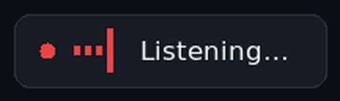

# VozLab

**Local, private voice dictation for Windows.** Hold a key, speak, release — your
words appear in whatever app you're using, formatted. Speech recognition and text
cleanup run on **your own machine**. No cloud, no subscription, no account, and no
audio leaving your network.

<p align="center">
  
</p>

<div class="grid cards" markdown>

- :material-microsoft-windows: **[Install the app](CLIENT.md)** — 2 minutes, no admin
  rights, works with Smart App Control enabled.

- :material-server: **[Set up the server](SERVER.md)** — one command on any machine
  with Docker.

- :material-shield-lock: **[How private is it?](PRIVACY.md)** — everything VozLab
  stores and sends, plus how to verify it yourself.

- :material-speedometer: **[Models & speed](MODELS.md)** — pick a model for your
  hardware.

</div>

## The 30-second version

```
        your laptop (Windows)                      your server (Docker, on your LAN)
 ┌──────────────────────────────────┐      ┌────────────────────────────────────────────┐
 │  hold right Ctrl ──► record mic  │      │  Whisper  speech → text (GPU or CPU)       │
 │        │                         │      │      │                                     │
 │        └── POST /transcribe ─────┼─────►│      ▼                                     │
 │            (WAV + token)         │      │  local LLM  cleanup (fillers, punctuation) │
 │                                  │      │      │  guard: never invents words        │
 │  paste into the focused app ◄────┼──────┤      ▼                                     │
 └──────────────────────────────────┘      └────────────────────────────────────────────┘
```

Typical wait: **under a second on a GPU** (0.5–0.9 s for a six-second sentence),
a few seconds on CPU only.

## Start here

=== "I want to use it"

    1. Install the app — [Install the app (Windows)](CLIENT.md)
    2. Set up a server — [Set up the server](SERVER.md)
    3. Follow the wizard: server URL + token, your dictation key, microphone test.

=== "I want to understand it"

    - [Architecture](ARCHITECTURE.md) — how the two halves fit together
    - [Privacy](PRIVACY.md) — the complete data story
    - [Models & performance](MODELS.md) — accuracy vs speed vs VRAM

=== "Something is broken"

    - [Troubleshooting](TROUBLESHOOTING.md) — the top failure modes
    - [FAQ](FAQ.md) — the questions people ask first
    - Still stuck? *Settings → System → Export diagnostics*, then open an issue

## Features

- 🎙️ Dictation into any Windows app, hold-to-talk or toggle, optional auto-stop
- ✨ Local AI cleanup: filler words removed, punctuation and capitalisation fixed,
  your language preserved (English and Spanish tested)
- 🌍 Multilingual with automatic detection (90+ languages)
- 🔒 Zero telemetry, no audio on disk, transcripts never written to the log
- 🔑 Token encrypted with Windows DPAPI; per-device tokens you can revoke
- 🛠️ Unified settings: change models and language on the server from the app
- 🐳 Server runs on NVIDIA GPU, CPU-only, NAS or Raspberry Pi
- 📋 Clipboard-safe pasting, dark **and light** themes, first-run wizard

Full feature list and screenshots: the
[repository README](https://github.com/diegosg-dev/vozlab#readme).
